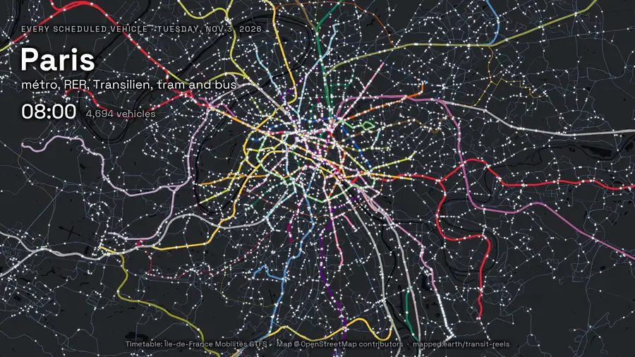
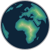
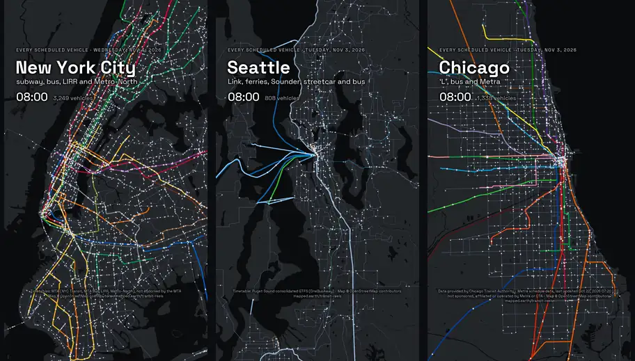
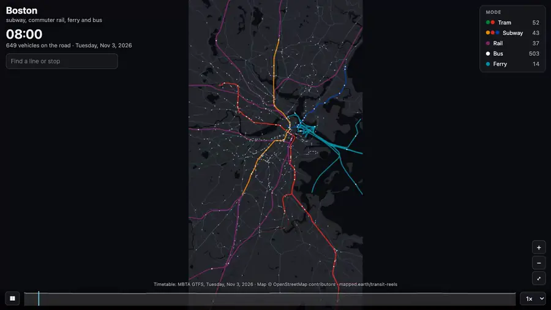
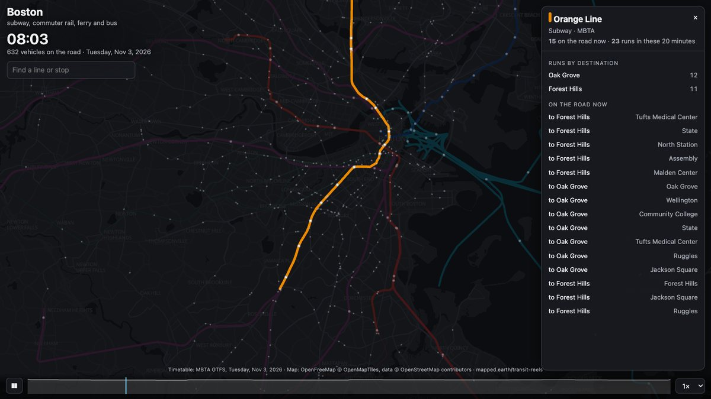
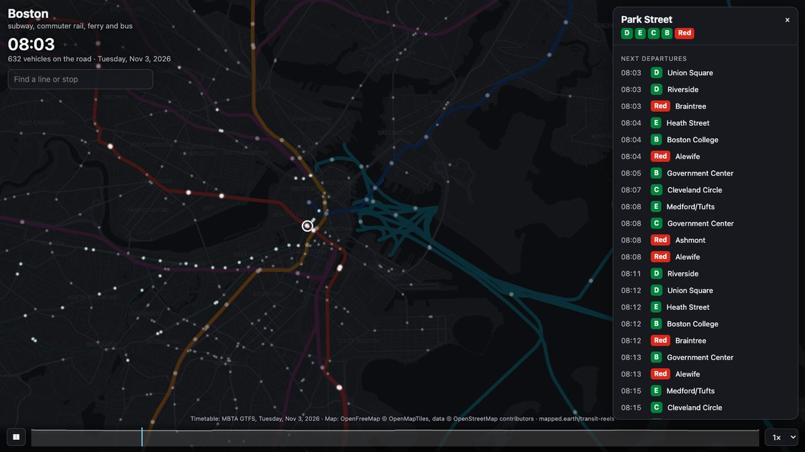
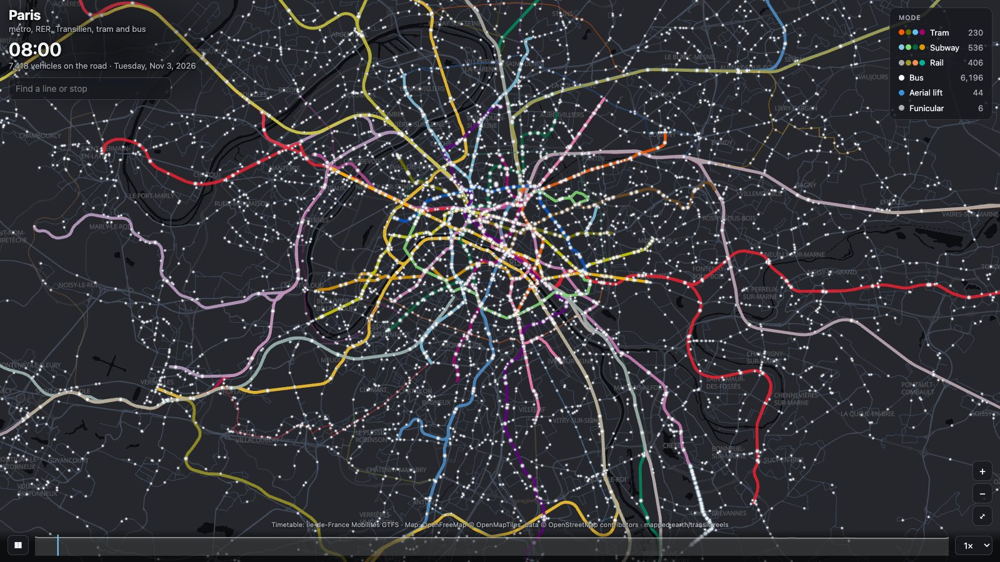
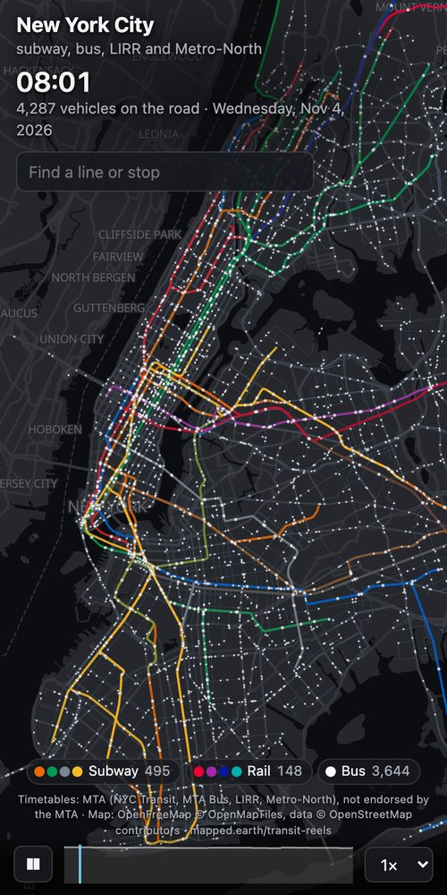

<p align="center">
  
</p>

<p align="center">
  <a href="https://mapped.earth"></a>
</p>

<h1 align="center">transit-reels</h1>

<p align="center">
  <b>Every bus, train, tram and ferry a city's timetable puts on the road, as a dot moving across the map.</b><br>
  Give it a city's public GTFS feed. Get a video for Reels, Shorts, X or LinkedIn, and an interactive map you can tap.
</p>

<p align="center">
  An open-source tool from <a href="https://mapped.earth"><b>mapped.earth</b></a>, maps and short films about the shape of the planet.<br><br>
  <a href="https://mapped.earth/transit-reels"><b>See it on mapped.earth</b></a> ·
  <a href="#make-one-with-a-coding-agent">Make one</a> ·
  <a href="#the-interactive-page">The interactive map</a> ·
  <a href="#how-it-works">How it works</a><br><br>
  <a href="https://github.com/aaronjbecker/transit-reels/actions/workflows/test.yml"></a>
  
  
</p>

<p align="center">
  
</p>

It reads the timetable the agency publishes, works out where each vehicle is at every second
of the window, and draws it. No API keys, no GIS libraries, no browser automation: Python with
numpy and Pillow, plus a bundled ffmpeg.

| Paris | New York | Seattle |
|---|---|---|
| 11,223 runs in 20 minutes, 841 of them métro | 5,845 runs, nine MTA feeds merged | 1,486 runs, 36 of them ferries |

Every reel above was made from a recipe in [`recipes/`](recipes), so you can make it again
exactly.

## Make one with a coding agent

You don't need to know Git, Python or the command line. You need an AI agent that can run
programs on your computer: the [Claude desktop app](https://claude.ai/download) (its Code
tab) or Claude Code, OpenAI's Codex, Cursor, or any agent that reads `AGENTS.md`. A chat in
a web browser can't do it, because it can't run programs on your machine.

1. Make an empty folder (for example `transit` in your Documents) and open it in the agent.
2. Paste this, with your city:

   > Make a transit reel of Chicago's morning rush with https://github.com/aaronjbecker/transit-reels

3. Say yes when it asks to download the tool and run it. It shows you one still frame before
   it makes the video; tell it what to change, in your own words.

The video, a horizontal version and the interactive page end up in
`transit-reels/work/<city>/`.

Agents: the setup steps are in [AGENTS.md](AGENTS.md).

## Quick start (if you use a terminal)

With [uv](https://docs.astral.sh/uv/) (it installs Python and the dependencies itself):

```bash
git clone https://github.com/aaronjbecker/transit-reels && cd transit-reels
uv run transit-reels render recipes/boston.toml
```

The video lands in `work/boston/boston.mp4`. Or with pip: `pip install -e .`, then
`transit-reels render recipes/boston.toml`.

## Your city

```bash
uv run transit-reels find lyon                 # search ~2,900 active GTFS feeds
uv run transit-reels inspect <feed url>       # modes, dates covered, trips per day
cp recipes/example.toml recipes/lyon.toml      # set title, feed url, attribution
uv run transit-reels still recipes/lyon.toml   # one frame, to check the framing
uv run transit-reels render recipes/lyon.toml
uv run transit-reels render recipes/lyon.toml --format horizontal   # 16:9 for X, LinkedIn
uv run transit-reels web recipes/lyon.toml     # the interactive page, one HTML file
uv run transit-reels stats recipes/lyon.toml   # runs, paths, vehicles moving: caption numbers
```

A reel shows the morning peak, 08:00 to 08:20 in ten seconds: slow enough to follow a single
train. Any other stretch or length is a setting in the recipe (`[time] start` and `minutes`,
`[video] seconds`), e.g. the evening rush, or a 30-second reel. `recipes/example.toml` explains
every setting.

A few agencies want a (free) API key. `find` says which, and where to sign up; store the key
with `uv run transit-reels key set <name>`, which keeps it out of the recipe in a private file.
Until then the tool uses the keyless Mobility Database mirror.

## The interactive page

<p align="center">
  
</p>

`web` writes one HTML file. The vehicles run over a full-screen base map
([OpenFreeMap](https://openfreemap.org): OpenStreetMap data, free, no key) in the reel's
colors. It opens on the reel's framing for the screen's shape, vertical on a phone and
horizontal on a desktop, and you can pan and zoom past it to every line in the feed. With no
connection it falls back to the reel's still map. Play, pause and scrub the window (the strip
at the bottom charts how many vehicles are on the road), drag and pinch or scroll to zoom, and:

- hover or tap a vehicle: its line, destination, operator and every scheduled stop with its
  time, the next one marked; follow it, or open its whole line;
- tap a line: drawn bright over the dimmed map, with how many runs it makes in the window to
  each destination and where each of its vehicles is now;
- tap a stop (zoom in to see them) or search for one: the next departures from every
  platform of that name, on every line;
- read the legend: each mode in the colors it is drawn in, with a live count; tap a mode to
  hide it.

<table>
  <tr>
    <td width="50%"></td>
    <td width="50%"></td>
  </tr>
  <tr>
    <td><b>A line.</b> Boston's Orange Line: 23 runs in the window, and where each train is now.</td>
    <td><b>A stop.</b> Park Street: every platform, every line, the next departures.</td>
  </tr>
  <tr>
    <td></td>
    <td align="center"></td>
  </tr>
  <tr>
    <td><b>Desktop.</b> Paris opens wide, on a free OpenStreetMap base map, and zooms to street level.</td>
    <td><b>Phone.</b> New York opens on the vertical reel's framing; the legend becomes chips.</td>
  </tr>
</table>

Everything shown comes from the published timetable. It is not live positions.

## Put it on a website

`uv run transit-reels web recipes/lyon.toml --embed <folder>` writes the player as plain
files (one JavaScript module, no build step) to drop into any site, SvelteKit included.
[docs/embed.md](docs/embed.md) has the snippet and the options.

## How it works

1. **Which vehicles run.** A trip runs on a date if its `service_id` does (`calendar.txt`,
   with the `calendar_dates.txt` exceptions). Trips from the day before whose times run past
   24:00 are still out after midnight and are carried over. Headway-based service
   (`frequencies.txt`) is expanded into one vehicle per headway.
2. **Where each stop is on the route.** Every stop is projected onto the route's shape,
   in order, never going backwards, so loops and out-and-back routes come out right.
3. **Where the vehicle is.** Between two stops the vehicle moves along the shape at constant
   speed; at a stop it waits from arrival to departure. Stops without times are given times
   by distance between the timed stops either side.
4. **The picture.** The map is drawn once (land, OpenStreetMap water, the network's lines);
   each frame adds a soft dot per vehicle and the clock.

The day defaults to the next ordinary Tuesday to Thursday in the feed, from tomorrow: the
earliest whose trip count is within 3% of the busiest in the next three weeks, so a holiday timetable is
skipped. Times are the agency's local time.

## Data and credit

Each feed has its own license; `find` prints it and the recipe's `attribution` is drawn on
the map. Water comes from © OpenStreetMap contributors (ODbL), credited automatically. The
feed catalog is the [Mobility Database](https://mobilitydatabase.org). Every reel also
carries a small `mapped.earth/transit-reels` credit; please leave it in when you post.

Space Grotesk (the typeface) is under the SIL Open Font License; see
`src/transit_reels/fonts/OFL-SpaceGrotesk.txt`.

## Made by

<table>
  <tr>
    <td width="136" valign="top">
      <a href="https://mapped.earth/about"></a>
    </td>
    <td valign="top">
      I'm <b>Aaron J. Becker</b>. I make maps and short films about the shape of the planet at
      <a href="https://mapped.earth"><b>mapped.earth</b></a>: winds, currents, terrain, cities,
      and the data underneath them.<br><br>
      The tool is free and stays that way. For a narrated film about a network change, an
      interactive on your ridership or real-time data, or a map for a service redesign, I take
      commissions from agencies, newsrooms and advocates:
      <a href="mailto:Aaron@mapped.earth">Aaron@mapped.earth</a> ·
      <a href="https://mapped.earth/about#work-with-me">Work with me</a><br><br>
      <a href="https://mapped.earth">mapped.earth</a> ·
      <a href="https://instagram.com/mapped.earth">Instagram</a> ·
      <a href="https://www.youtube.com/@mapped-earth">YouTube</a>
    </td>
  </tr>
</table>

## License

MIT, © Aaron J. Becker.

<p align="center"><br>
  <a href="https://mapped.earth"></a><br>
  <a href="https://mapped.earth"><sub><b>mapped.earth</b></sub></a>
</p>
